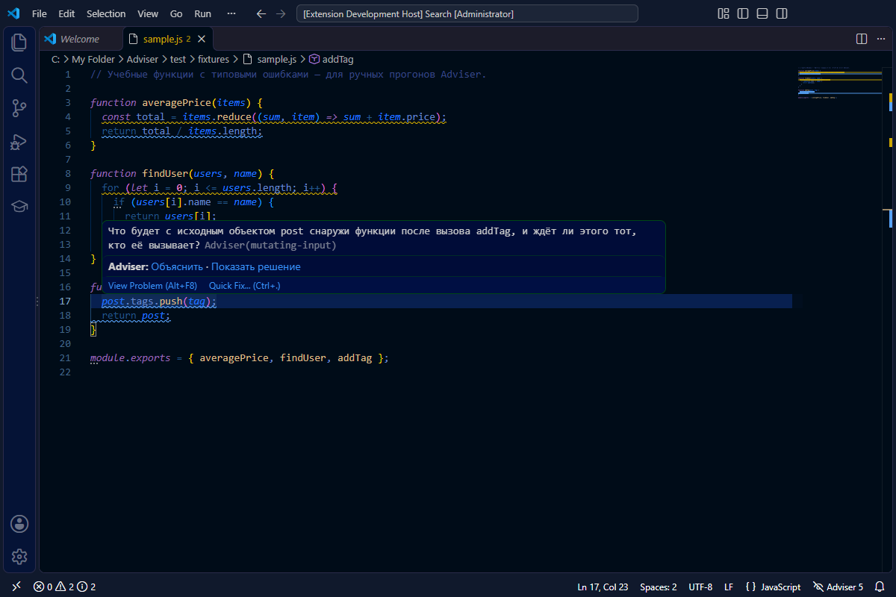
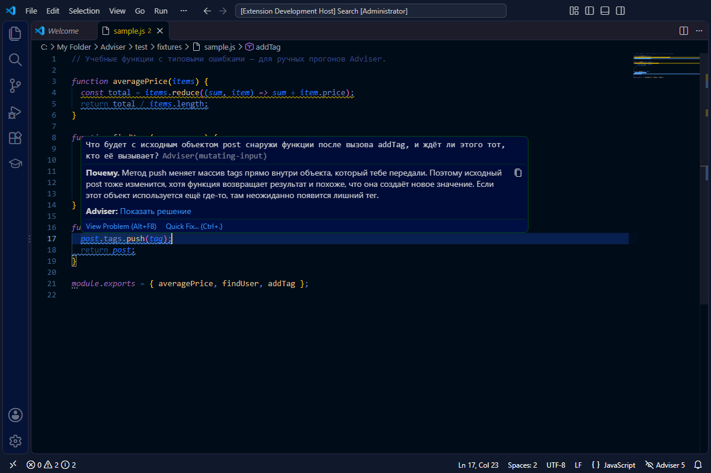
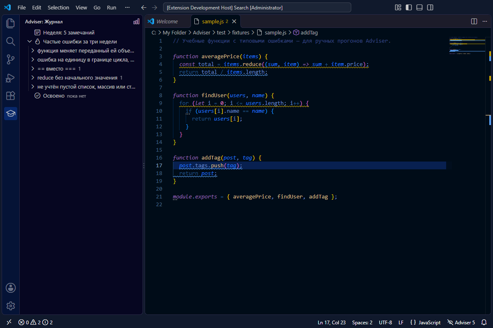
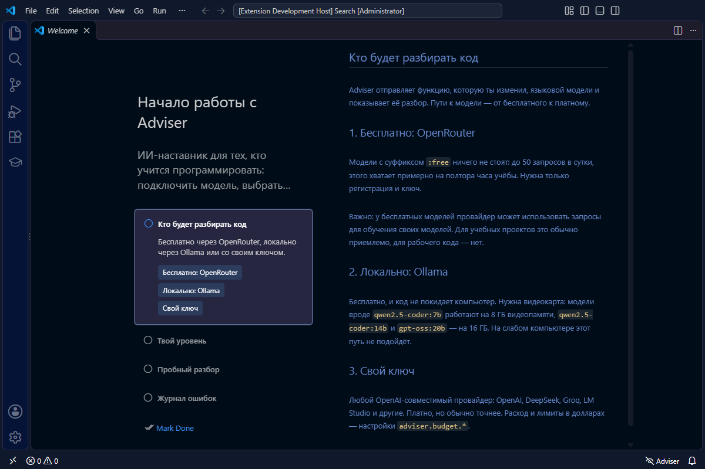
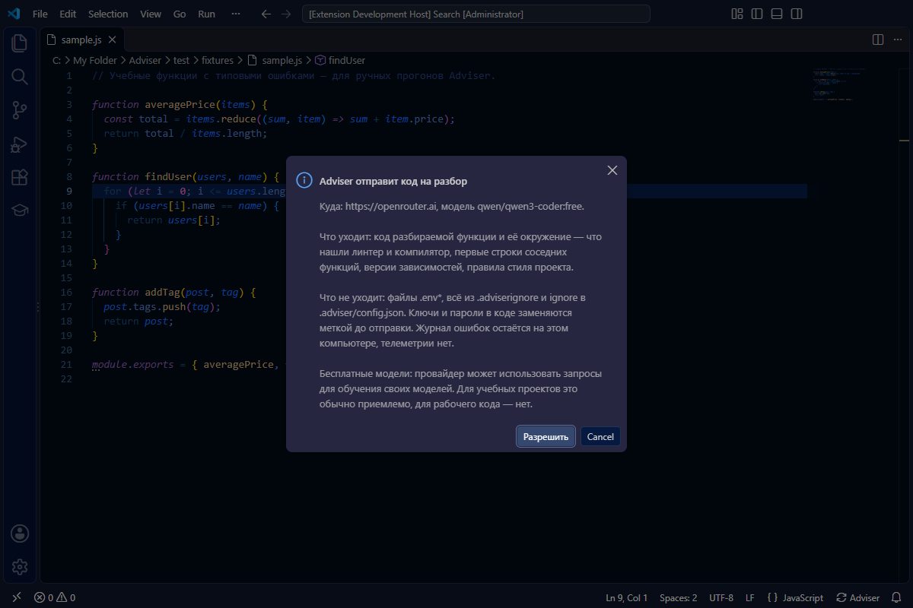

# Adviser

ИИ-наставник в VS Code для тех, кто учится программировать. Он замечает функцию, которую ты только что изменил, и разбирает её как наставник: не «вот баг, вот исправление», а «что вернёт эта строка, если список пуст?». Объяснение — по кнопке, готовый код — последним, когда ты сам не дошёл.

**Статус:** 0.5, предварительный выпуск. В Marketplace пока нет — ставится из `.vsix`. План и принятые решения — в [docs/PLAN.md](docs/PLAN.md), изменения — в [CHANGELOG.md](CHANGELOG.md).

## Как это работает

1. **Намёк.** Подчёркивание с вопросом, который подводит к ошибке, но не называет её.
2. **Объяснение.** Кнопка «Объяснить» в подсказке при наведении: почему это ошибка, 2–4 предложения.
3. **Решение.** Кнопка «Показать решение». Применить его можно из лампочки — через предпросмотр.





Если код сломан или небезопасен, намёка нет — сразу объяснение. Если всё в порядке, Adviser молчит: «замечаний нет» — нормальный ответ.

**Сам, без команды.** В режиме «Наставник» Adviser разбирает функции, которые ты правил: когда сохраняешь файл, уходишь из функции или 30 секунд ничего не печатаешь. Правки только в пробелах и комментариях не считаются. Режимы и «Не беспокоить» — по клику на Adviser в статус-баре.

**Помнит твои ошибки.** Если ошибка повторяется в третий раз за неделю, Adviser напомнит и покажет прошлый случай. В боковой панели «Журнал» — неделя, частые ошибки и то, что ты уже освоил; команда «Adviser: Отчёт за неделю» показывает, сколько ошибок ты исправил сам. Журнал хранится только на твоём компьютере.



## Установка

1. Скачай `adviser-*.vsix` со страницы [Releases](https://github.com/ivan11111111a-netizen/adviser/releases).
2. В VS Code: «Extensions: Install from VSIX…» — или `code --install-extension adviser-0.5.0.vsix`.
3. Откроется мастер «Начало работы с Adviser»: подключи модель, выбери уровень, попробуй разбор. Открыть его снова — команда «Adviser: Начало работы».



Нужен VS Code 1.101 или новее. Cursor и Windsurf должны подойти — версия выбрана ради них, — но в них Adviser ещё не проверяли. Разбираются JavaScript, TypeScript и Python; по команде — любой язык.

## Кто разбирает код

| Путь | Сколько стоит | Что нужно |
|---|---|---|
| **OpenRouter**, модели `:free` | бесплатно, до 50 запросов в сутки | регистрация и ключ |
| **Ollama** на своём компьютере | бесплатно, код не уходит в сеть | видеокарта от 8 ГБ (`qwen2.5-coder:7b`), лучше 16 ГБ |
| **Свой ключ** OpenAI-совместимого провайдера | платно | ключ; лимиты в долларах — `adviser.budget.*` |

У бесплатных моделей провайдер может учиться на запросах: для учебного кода это обычно приемлемо, для рабочего — нет.

## Режимы

| Режим | Когда разбирает | Как показывает |
|---|---|---|
| Наставник (по умолчанию) | сохранение, уход из функции, пауза 30 с; до 20 разборов в час | по ступеням |
| Ревьюер | сохранение, уход из функции; до 6 в час | сразу объяснение и решение |
| Вручную | только по команде «Разобрать эту функцию» | по ступеням |

## Настройки

| Настройка | Что задаёт |
|---|---|
| `adviser.mode` | режим: `mentor`, `reviewer`, `manual` |
| `adviser.level` | уровень: `beginner`, `intermediate`, `advanced` — о чём говорить, о чём молчать |
| `adviser.language` | язык советов: `auto` (по языку VS Code), `ru`, `en` |
| `adviser.provider`, `adviser.baseUrl`, `adviser.model` | кто разбирает; только пользовательские, проект их не меняет |
| `adviser.hiddenPatterns` | типы ошибок, о которых больше не говорить (пополняется из лампочки) |
| `adviser.budget.*` | цены своего ключа и лимиты в долларах в день и в месяц |

Ключ задаётся командой «Adviser: Задать API-ключ» и хранится в защищённом хранилище VS Code.

### Настройки проекта

Их кладут в репозиторий — например, преподаватель для всей группы.

- `.adviser/config.json` — триггеры, лимиты, уровень, язык, минимальная серьёзность, категории, игнор. VS Code подсказывает поля. Лимиты проект может только ужесточить, а включить автопилот тому, кто выбрал «Вручную», не может.
- `.adviser/rules.md` — правила стиля обычным текстом.
- `.adviserignore` — что не отправлять, в синтаксисе `.gitignore`.

```json
{
  "level": "beginner",
  "triggers": { "idleSeconds": 0 },
  "minSeverity": "warning",
  "ignore": ["generated/**"]
}
```

## Приватность

Код уходит только выбранной тобой модели и только после твоего разрешения; `.env*` и игнор-файлы не уходят никогда, ключи в коде маскируются. Телеметрии нет. Подробно — в [PRIVACY.md](PRIVACY.md).



## Чего Adviser не умеет

Он не заменяет курс, наставника и код-ревью в команде. Он видит функцию и её окружение, а не архитектуру проекта целиком, и не видит, что ты застрял, — только код и паузы в наборе. Его сила — быстрая обратная связь на то, что ты только что написал.

## Разработка

Нужны Node.js 22+ и VS Code. Правила для ИИ-агентов и архитектура — в [AGENTS.md](AGENTS.md).

```sh
npm install
npm run lint              # ESLint
npm run format:check      # Prettier
npm run check-types       # tsc
npm run test:unit         # Vitest: ядро без VS Code
npm run test:integration  # тесты внутри VS Code (@vscode/test-cli)
npm run eval              # качество советов на наборе учебных функций (ходит в модель)
npm run package:vsix      # собрать .vsix
```

Запуск расширения — F5 в VS Code (Extension Development Host).

## Лицензия

[MIT](LICENSE)
